# PetMatch — Diseño UI/UX de una plataforma de adopción de animales

Proyecto de diseño UI/UX en **Figma**: web de escritorio y app móvil que conecta a personas que quieren adoptar con protectoras de Valencia, mostrando el **% de encaje** entre la persona y cada animal.

🔗 **Archivo de Figma:** https://www.figma.com/design/S2X1LA1cdTpfQJC76Jqwzw/PetMatch-%E2%80%94-Dise%C3%B1o-UI-UX

## Flujo principal (7 pantallas × escritorio y móvil)

| # | Pantalla | Escritorio | Móvil |
|---|---|---|---|
| 01 | Home / Descubrir | 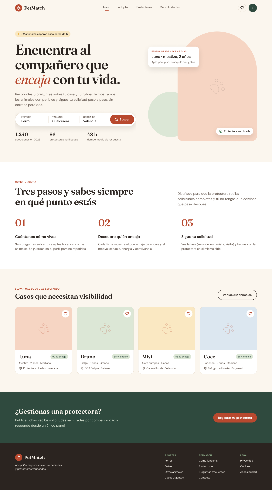 | 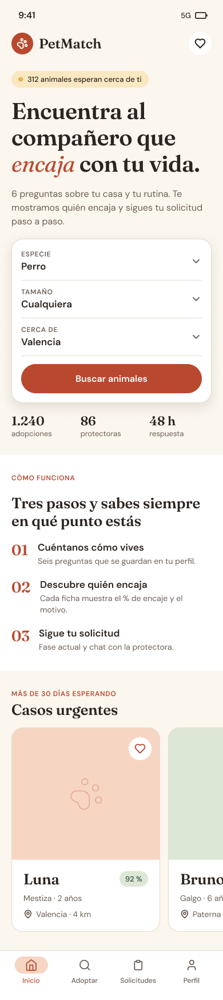 |
| 02 | Catálogo con filtros | 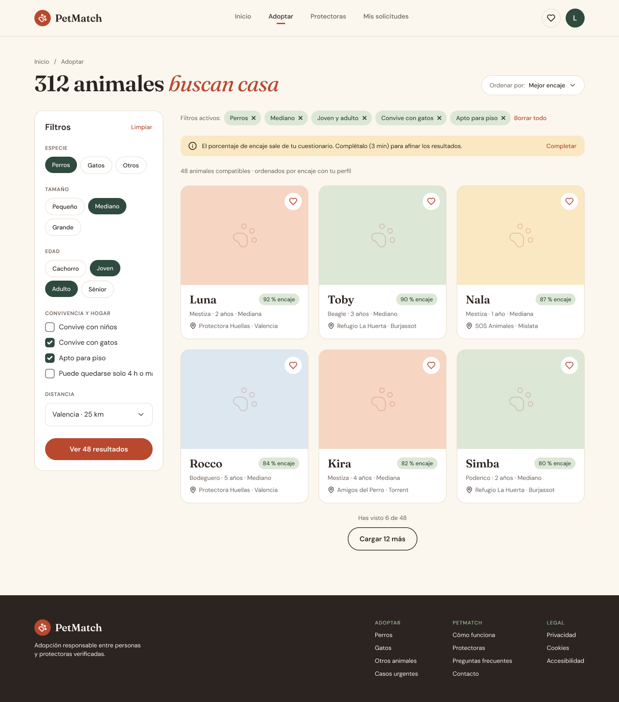 | 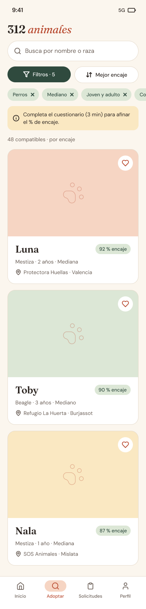 |
| 03 | Ficha del animal | 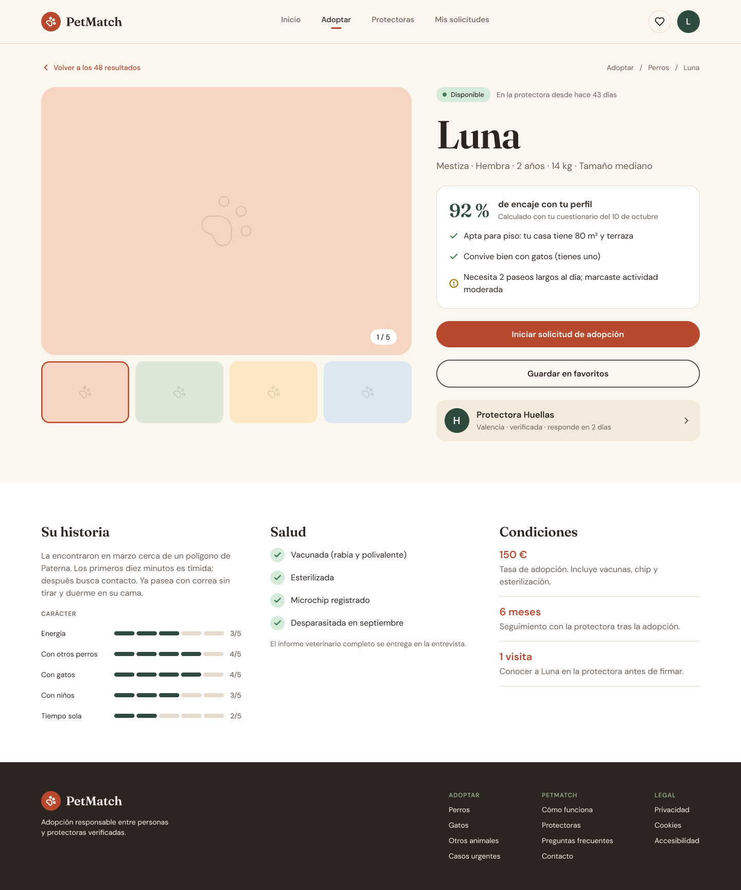 | 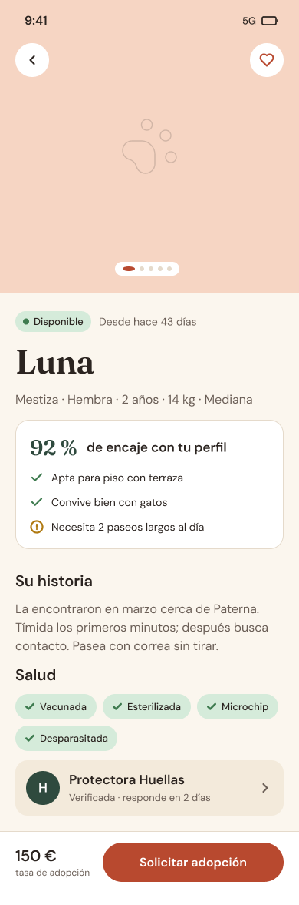 |
| 04 | Cuestionario de pre-adopción | 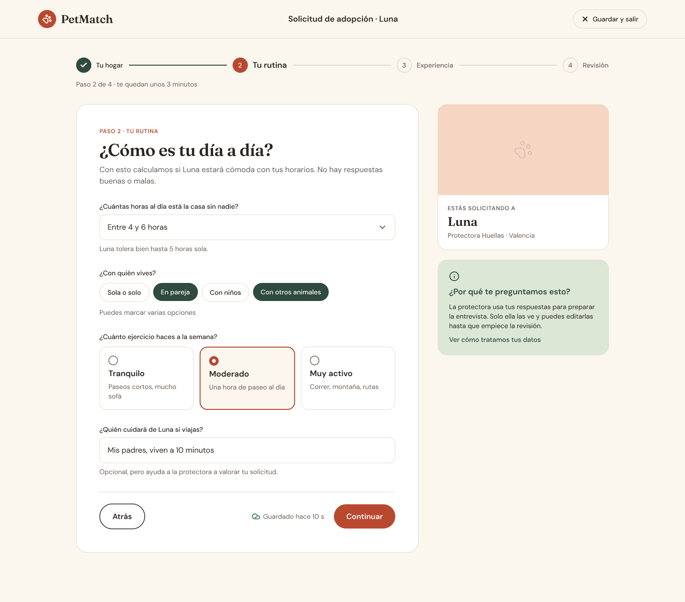 | 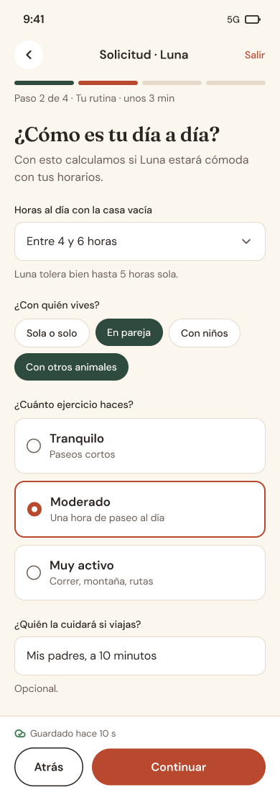 |
| 05 | Confirmación y próximos pasos | 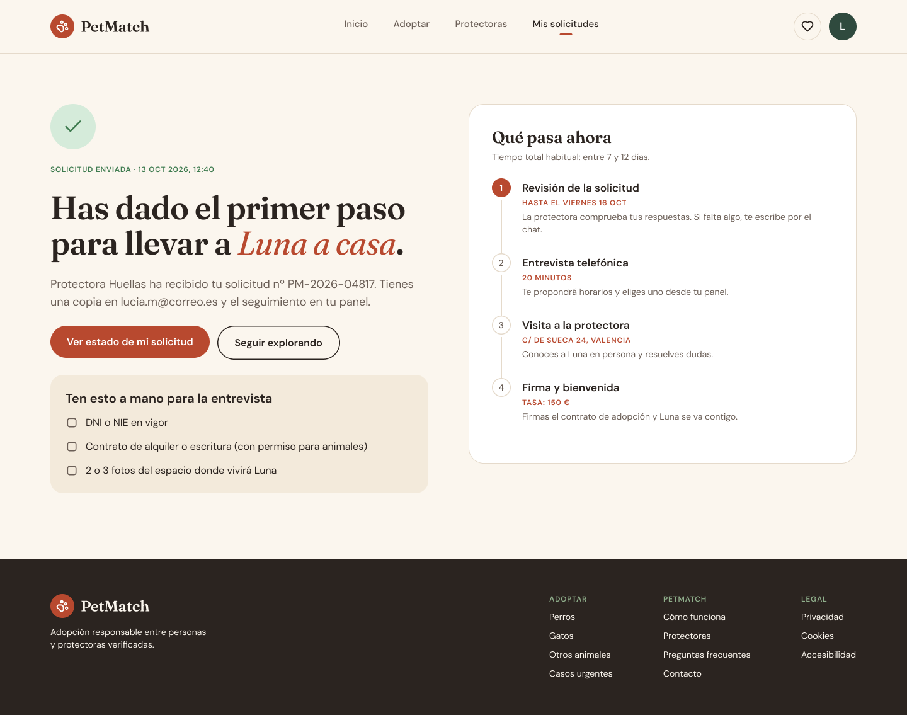 | 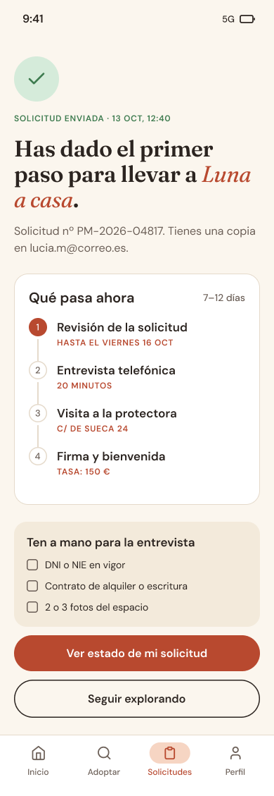 |
| 06 | Panel de usuario / Mis solicitudes | 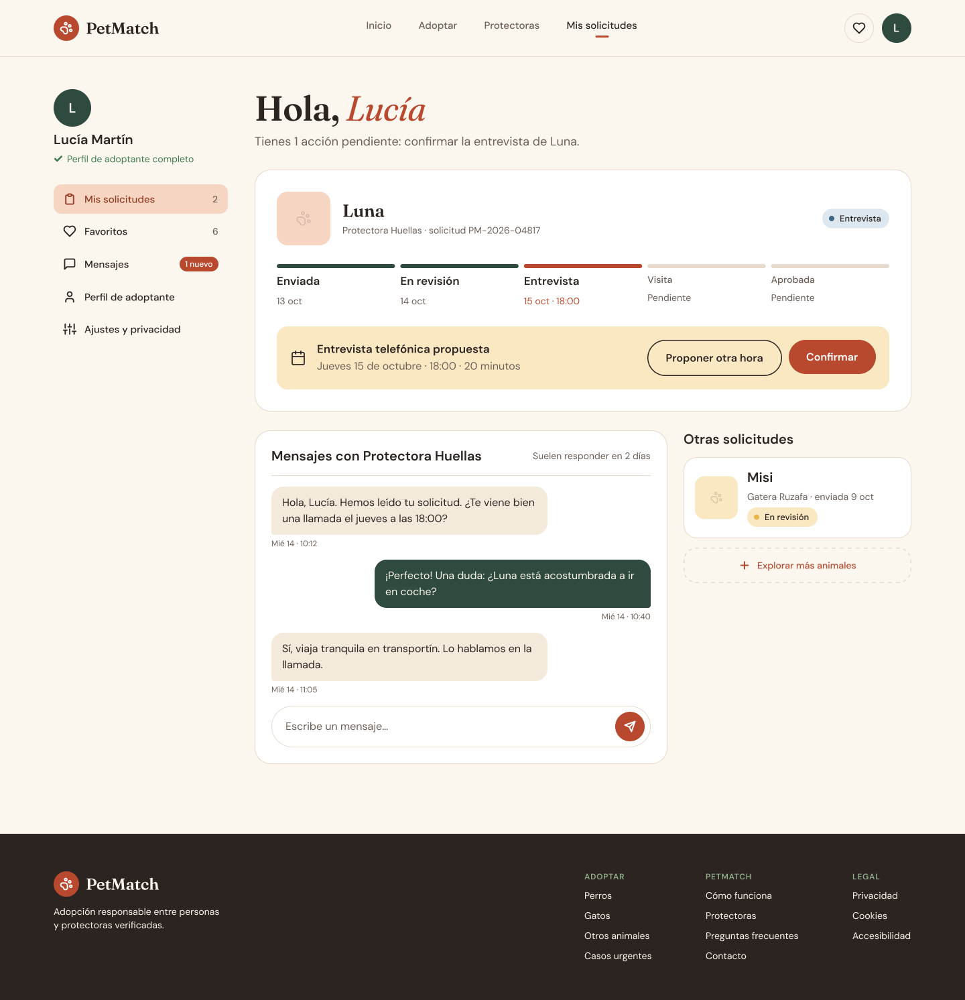 | 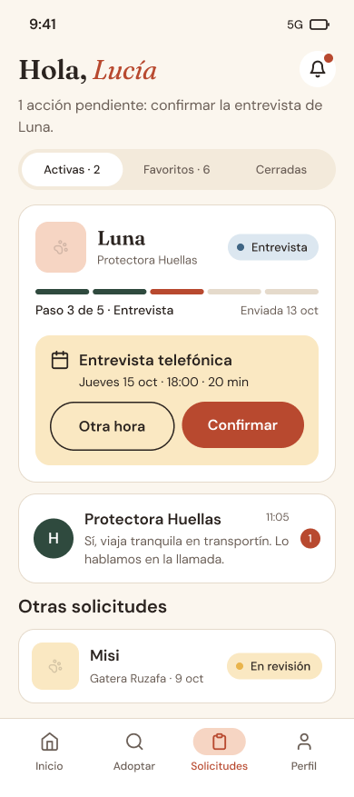 |
| 07 | Perfil de la protectora | 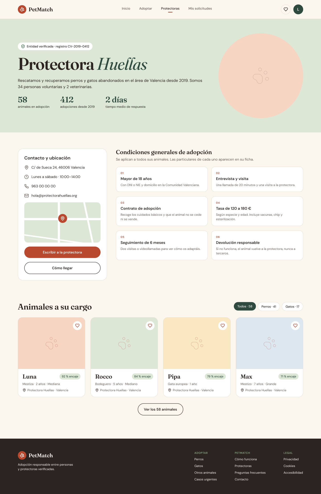 | 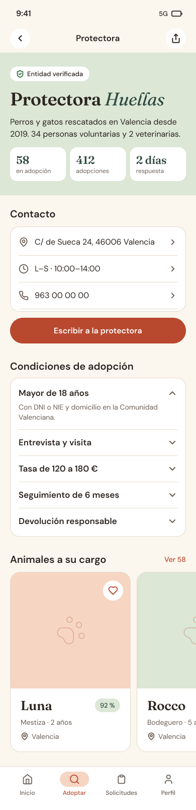 |

## Fundamentos de diseño

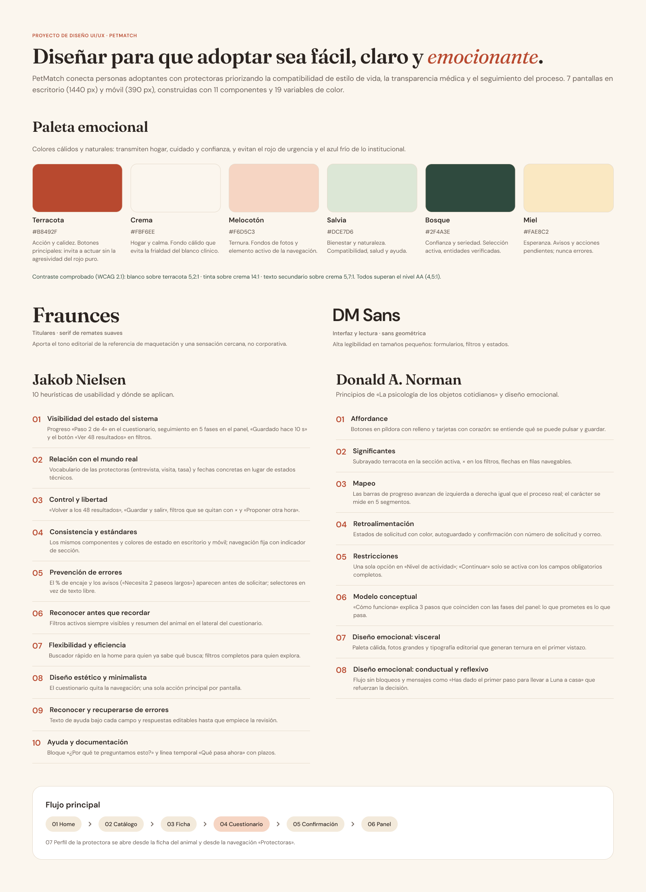

- **Paleta emocional:** Terracota `#B8492F`, Crema `#FBF6EE`, Melocotón `#F6D5C3`, Salvia `#DCE7D6`, Bosque `#2F4A3E`, Miel `#FAE8C2`. Contraste comprobado según **WCAG 2**.
- **Tipografía:** Fraunces (titulares) + DM Sans (interfaz y lectura).
- **Usabilidad:** las 10 heurísticas de **Jakob Nielsen** aplicadas a pantallas concretas (progreso «Paso 2 de 4», filtros activos visibles, prevención de errores con el % de encaje…).
- **Psicología del diseño:** principios de **Donald A. Norman** — affordance, significantes, mapeo, retroalimentación, restricciones, modelo conceptual y diseño emocional.

## Sistema de componentes

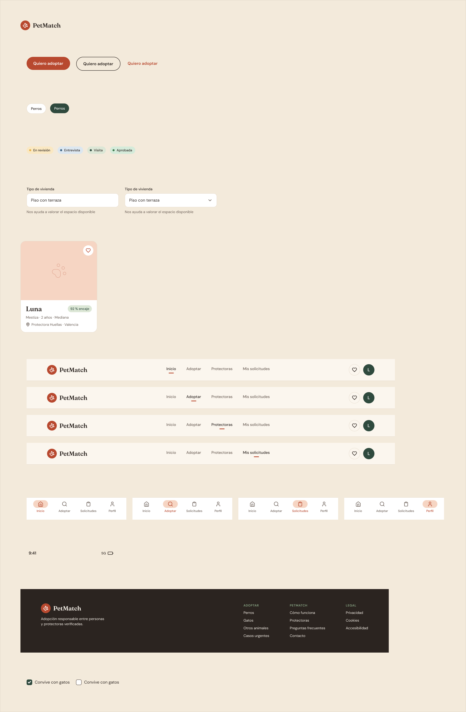

Logo, botones (primario, secundario, texto), chips de filtro, estados de solicitud, campos de formulario, tarjeta de animal, navegación de escritorio, barra de pestañas móvil, barra de estado, pie y casillas, todos con **variantes** y reutilizados en las 14 pantallas.

## Herramientas
Figma (componentes, variantes, auto layout, diseño responsive escritorio / móvil) · plugin propio de Figma en JavaScript para completar el diseño.

---
Rafael Izquierdo · [github.com/rafael131519](https://github.com/rafael131519)
